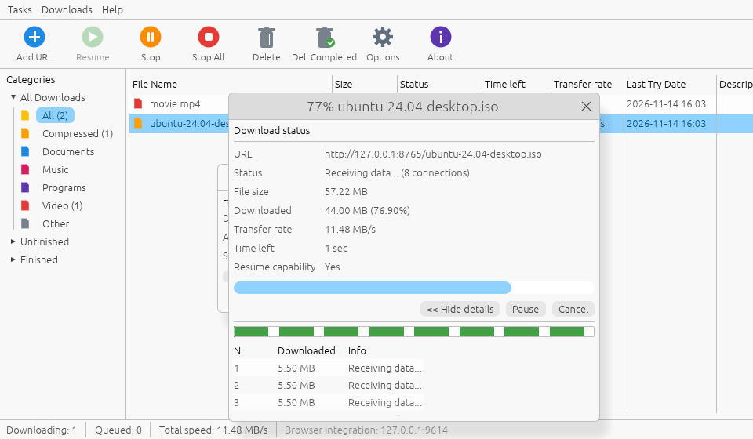

# RDM - Rust Download Manager

A small, fast, free and open source download manager written in Rust, modelled
after the classic Internet Download Manager: multi-connection downloads,
pause/resume, categories, a download queue and a browser extension that picks
up downloads, videos and audio from web pages.



- **Multi-connection downloads** - files are split into segments that download
  in parallel. When a connection finishes early it takes over half of the
  largest remaining segment (dynamic segmentation), so every connection stays
  busy until the end.
- **Pause / resume** - also after closing RDM or restarting the computer, for
  every server that supports range requests. Broken connections are retried
  automatically.
- **Video and audio grabbing** - the browser extension detects media on a page
  and shows a *Download this video* button over the player. HLS streams
  (`.m3u8`, including AES-128 encrypted ones) are downloaded segment by segment
  and joined into one file.
- **Torrents** - magnet links, `.torrent` files and `.torrent` URLs, with a
  checklist to pick which files of the torrent to download. Magnet links
  clicked in the browser open in RDM. Torrents stop when complete (no
  seeding afterwards).
- **Browser integration** - downloads of the file types you choose are taken
  over from Chrome, Edge, Brave and Firefox automatically, with cookies and
  referer so logged-in downloads work. There is also a *Download with RDM*
  context menu.
- **IDM-like interface** - toolbar, category tree (Compressed, Documents,
  Music, Programs, Video), sortable list, *Download File Info*, progress window
  with per-connection details and *Download complete* dialog.
- **Queue and speed limiter** - choose how many downloads run at once,
  connections per download and a global speed limit.
- **Light** - a single native binary of a few MB, no runtime, no bundled
  browser engine. Idle CPU use is zero.

> RDM does not download DRM protected streams (for example Netflix or Widevine
> content). Respect the terms of the sites you use.

## Download

Get the archive for your system from the
[Releases page](https://github.com/otkhovps-sys/rdm/releases), unpack it and
run `rdm` (`rdm.exe` on Windows). Every archive also contains the browser
extension in the `extension` folder.

On Windows, if SmartScreen says *"Windows protected your PC"*, click
*More info* → *Run anyway* (the program is not code-signed). If RDM cannot
start it shows a message and writes `crash.log` to its data folder
(`%APPDATA%\rdm\data`).

**Portable mode:** put an empty file called `portable` next to the executable
and RDM keeps its settings and download list in a `data` folder beside it.

## Browser extension

The extension talks to RDM on `127.0.0.1:9614`; RDM must be running.

- **Chrome / Edge / Brave / Opera**: open `chrome://extensions`, turn on
  *Developer mode*, click *Load unpacked* and select the `extension` folder
  (or the unpacked `rdm-extension-chrome-*.zip` from the release page).
- **Firefox**: download `rdm-extension-firefox-*.zip` from the release page,
  open `about:debugging#/runtime/this-firefox`, click *Load Temporary Add-on*
  and select that zip file. (Firefox needs its own manifest, so the plain
  `extension` folder is for Chromium browsers only.)

If RDM is not running, the browser simply keeps downloading as usual.

## Usage

| Action | How |
| --- | --- |
| Add a download | *Add URL* (Ctrl+N), the URL is taken from the clipboard |
| Open a torrent | *Tasks → Open torrent file* (Ctrl+O), or paste a magnet link into *Add URL* |
| Download from the command line | `rdm https://example.com/file.zip`, `rdm "magnet:?..."` or `rdm file.torrent` (passed to the running RDM) |
| Pause / resume | toolbar, right-click menu, or the progress window |
| Open a finished file | double-click it |
| Show connections | double-click an unfinished download |
| Delete | Delete key, optionally removing the files from disk |

Downloads are saved to `Downloads/<Category>` by default; this can be changed
in *Options*.

## Building from source

Requires a recent stable Rust (1.85+).

```bash
cargo build --release
```

The binary is `target/release/rdm`. This optimized build is slow and uses
every CPU core for several minutes (whole-program LTO, plus C code from the
TLS library); that is normal and only happens while compiling. For a much
quicker build use:

```bash
cargo build --profile fast-release
```

and run `target/fast-release/rdm`. On Linux nothing besides the usual X11 or
Wayland libraries is needed at run time.

```bash
cargo test
```

## Project layout

```
crates/rdm-core     download engine, no GUI code
  src/engine.rs     queue, scheduling, persistence, public API
  src/http.rs       multi-connection segmented HTTP downloader
  src/hls.rs        HLS (.m3u8) downloader with AES-128 support
  src/torrent.rs    BitTorrent downloads (librqbit)
  src/probe.rs      asks the server for name, size and resume support
  src/limiter.rs    global speed limiter
crates/rdm-gui      the desktop app (egui), binary name `rdm`
  src/app.rs        main window: menu, toolbar, categories, status bar
  src/table.rs      download list
  src/dialogs/      add URL, file info, progress, options, ...
  src/server.rs     local endpoint for the browser extension
extension/          browser extension (Manifest V3, Chrome + Firefox)
```

## Tiếng Việt

RDM là trình quản lý tải xuống miễn phí, mã nguồn mở, viết bằng Rust, giao
diện và cách dùng giống IDM: tải đa luồng (chia nhiều kết nối), tạm dừng /
tiếp tục, phân loại tệp, hàng đợi, giới hạn tốc độ, tải torrent (magnet, tệp
`.torrent`, chọn từng tệp) và tiện ích trình duyệt tự
nhận diện video / âm thanh (kể cả luồng HLS `.m3u8`) để tải bằng một nút bấm.
Tải bản dựng sẵn ở trang *Releases*, giải nén và chạy `rdm`; cài tiện ích từ
thư mục `extension` như hướng dẫn ở trên.

## License

[MIT](LICENSE). Torrent support uses [librqbit](https://github.com/ikatson/rqbit)
(Apache-2.0).
